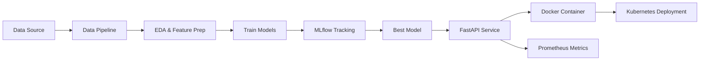

# Heart Disease Prediction MLOps Project Report

## 1. Objective
The project aims to build an end-to-end machine learning pipeline for predicting heart disease risk using the UCI Heart Disease dataset. The solution includes data preprocessing, model training, experiment tracking, model packaging, CI/CD testing, API serving, Dockerization, and deployment configuration.

Repository: [mlops-heart-disease-assignment](https://github.com/adityathiyyagura/mlops-heart-disease-assignment)

## 2. Dataset and problem definition
Dataset: Heart Disease UCI dataset
Goal: Binary classification of whether a patient is likely to have heart disease based on medical attributes.

## 3. Data acquisition and EDA
The dataset is downloaded from the UCI repository and cleaned by converting missing values, removing invalid rows, and converting the target to a binary label:
- 0 = no heart disease
- 1 = heart disease present

EDA includes:
- target class balance
- age distribution
- correlation heatmap
- summary statistics

Artifacts generated in the `artifacts/eda` directory.

## 4. Modeling choices
Two models were trained and evaluated:
- Logistic Regression
- Random Forest Classifier

The data was split once into an 80% development partition and a 20% held-out test partition using stratification and a fixed random seed. Five-fold `StratifiedKFold` cross-validation was run only on the development partition. The held-out partition was excluded from cross-validation and used for the final test metrics. Cross-validation values below are mean ± sample standard deviation across the five folds. The Random Forest was selected using mean CV ROC-AUC; the held-out results are reported separately and were not used for model selection.

### Five-fold stratified cross-validation (development data)

| Model | Accuracy | Precision | Recall | ROC-AUC |
|---|---:|---:|---:|---:|
| Logistic Regression | 0.827 ± 0.066 | 0.849 ± 0.096 | 0.769 ± 0.108 | 0.869 ± 0.077 |
| Random Forest | 0.810 ± 0.084 | 0.833 ± 0.124 | 0.760 ± 0.142 | 0.888 ± 0.062 |

### Final held-out test results

| Model | Accuracy | Precision | Recall | ROC-AUC |
|---|---:|---:|---:|---:|
| Logistic Regression | 0.833 | 0.846 | 0.786 | 0.950 |
| Random Forest (selected by CV) | 0.867 | 0.885 | 0.821 | 0.940 |

## 5. Experiment tracking
MLflow was configured to log the following for each run:
- hyperparameters
- mean and standard deviation of five-fold CV accuracy, precision, recall, and ROC-AUC
- separate held-out test accuracy, precision, recall, and ROC-AUC
- model artifact
- experiment metadata

The experiment is stored under `mlruns/`.

## 6. Reproducibility
The project stores the trained model and uses a consistent feature schema. Model inputs are passed in the same column order as training to maintain reproducibility.

## 7. API and packaging
A FastAPI service exposes a `/predict` endpoint. It accepts JSON patient data and returns:
- prediction
- risk label
- confidence score

The app is containerized using Docker and can be run locally with:

```bash
docker build -t heart-disease-api .
docker run -p 8000:8000 heart-disease-api
```

## 8. CI/CD
GitHub Actions runs lint/test/training automatically on pushes and pull requests.

## 9. Deployment and monitoring
A Kubernetes deployment manifest is provided under `k8s/deployment.yaml`. Monitoring is supported using Prometheus scraping metrics from the `/metrics` endpoint.

## 10. Architecture diagram



## 11. Setup instructions

```bash
python -m venv .venv
source .venv/bin/activate
pip install -r requirements.txt
python -m heart_disease_mlop.train
uvicorn app.main:app --host 0.0.0.0 --port 8000
```

## 12. Conclusion
This project demonstrates a practical, production-oriented MLOps workflow for building an ML application end to end, from data ingestion to deployment readiness.
